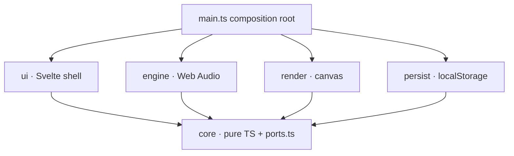
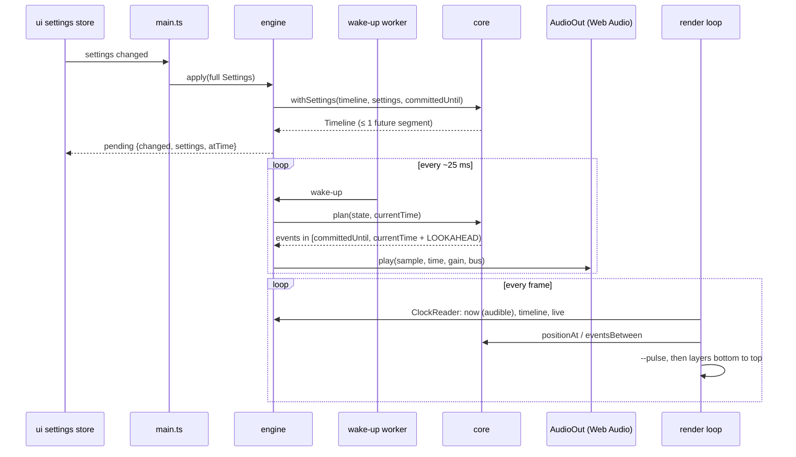
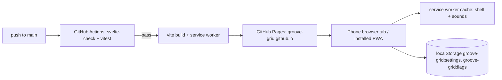

# Architecture Spine — Groove Grid v1

## Design Paradigm

**Functional core, imperative shell.** A pure TypeScript core holds the musical model and answers one question: *what is where at audio time `t`?* It also plans which events to schedule next. Everything that touches the browser — Web Audio, canvas, DOM, storage, service worker — is a thin adapter around it. Timing is never computed outside the core. A React Native port replaces adapters and reuses `src/core/` unchanged.

| Layer | Directory | May import |
| --- | --- | --- |
| Core (pure) | `src/core/` | nothing outside `src/core/` |
| Engine adapter (Web Audio) | `src/engine/` | `core` |
| Render adapter (canvas) | `src/render/` | `core` |
| Persistence adapter (storage) | `src/persist/` | `core` |
| UI shell (Svelte) | `src/ui/` | `core`, and the port types in `src/core/ports.ts` |
| Composition root | `src/main.ts` | everything; the only place adapters are constructed and wired |



## Invariants & Rules

### AD-1 — The audio clock is the only musical timebase [ADOPTED]

- **Binds:** CAP-2, CAP-3, CAP-4, CAP-7; `core`, `engine`, `render`
- **Prevents:** dot and click disagreeing; drift from accumulated intervals; timers or frames deciding when something sounds; a stair-stepping dot that leads the sound.
- **Rule:** All musical times are `AudioContext` seconds (`number`). Within a timeline segment, an event's time is `segment.startTime + (tick − segment.startTick) × secondsPerTick` — never a running sum. Only `src/engine/` reads the `AudioContext`. The scheduler uses raw `currentTime`. Visuals get "now" only from `ClockReader.now()`, which returns the **audible** context time: `getOutputTimestamp().contextTime` advanced by `(performance.now() − performanceTime) / 1000`, falling back to `currentTime − baseLatency − (outputLatency ?? 0)`; it never returns less than its previous value. It is computed only in `src/engine/clock.ts`, the one sanctioned use of `performance.now()` for timing. UI input timing (tap tempo, hold-to-repeat, drag) uses event timestamps and never becomes musical time directly.

### AD-2 — The core owns the timeline and the event plan

- **Binds:** CAP-1–CAP-5, CAP-7; `core`, `engine`, `render`
- **Prevents:** "pending" logic living in the UI or the scheduler; renderer and scheduler computing positions differently; scheduling logic that a React Native port can't reuse.
- **Rule:** `src/core/` has no DOM, Web Audio, Svelte or storage imports. A `Timeline` is an immutable list of segments carrying only the **metric** fields (`bpm, beats, beatUnit, clickBeats, betweenBeats, clickSound`). Segments are keyed by **absolute** integer tick since start, cover `[startTick, nextStartTick)`, and store `startTime` once when created; the event at a boundary tick belongs to the new segment, decided in ticks, never by comparing times. **Live** fields (`grid, markers, markerSound, muted`) are not in the Timeline; they pass as a separate `Live` value. Core functions: `startTimeline(settings, startTime)`, `withSettings(timeline, settings, committedUntil)`, `eventsBetween(timeline, live, t0, t1)` (half-open `[t0, t1)`), `positionAt(timeline, t)` (fractional tick in bar; clamps to 0 before `startTime`), and the scheduling planner `plan(state, now) → { events, state }`. The engine holds the current `Timeline` and `Live` and exposes them read-only through `ClockReader`; no other module builds one.

### AD-3 — Musical position is integer ticks, 960 per beat

- **Binds:** CAP-1, CAP-4, CAP-6, CAP-7, CAP-9; all layers
- **Prevents:** markers stored as angles in one story and 16th indexes in another; snapping, click plan and saved data disagreeing; a grid capped at 16ths.
- **Rule:** A beat is the meter's beat unit (the denominator note, /4 or /8). A position in the bar is an integer tick in `[0, beats × 960)`; the bar-relative tick is `(absTick − segment.barOriginTick) mod (beats × 960)`. A subdivision is its **division per beat** (`1` beats, `2` 8ths, `4` 16ths, `3` triplets); its step is `960 / division`, and only divisions that divide 960 are valid (septuplets are out). Events, markers and persisted data use integer ticks; only `positionAt` returns a fractional tick. Core owns `snap(barFraction, settings) → tick` (nearest line of the finest visible level, wrapping at 12 o'clock) and `tickLabel(tick, settings)` (e.g. `a of 2`). Only `src/render/` converts between ticks and screen geometry (beat 1 at 12 o'clock, clockwise).

### AD-4 — One settings store is the sole writer; the `Settings` shape is fixed

- **Binds:** CAP-1, CAP-3–CAP-7, CAP-9; `ui`, `persist`, `engine`
- **Prevents:** two components holding diverging copies of tempo or markers; data that doesn't survive JSON; unvalidated saved data entering the app.
- **Rule:** `src/core/settings.ts` defines exactly this shape (plain JSON, no `Set`/`Map`/classes):

  ```ts
  type Division = 1 | 2 | 4 | 3            // per beat: beats · 8ths · 16ths · triplets
  interface Settings {
    bpm: number                            // integer 30–250, counts the beat unit
    beats: number                          // 1–16
    beatUnit: 4 | 8
    grid: Division                         // finest visible level
    clickBeats: boolean[]                  // length === beats, at least one true
    betweenBeats: Division                 // 1 = None
    clickSound: ClickSoundId
    markerSound: MarkerSoundId | null      // null = Off
    markers: number[]                      // sorted, unique ticks on a visible grid line
    muted: boolean
  }
  ```

  Core `normalize(unknown) → Settings` is the only validator; store actions and loading both use it. `src/ui/settings.svelte.ts` is the only module that mutates settings, via named actions (`setTempo`, `setMeter`, `toggleBeat`, `placeMarker`, `moveMarker`, …); a drag changes nothing until release, then commits one `moveMarker`. Bulk marker removals (grid-family switch, coarser grid, meter shrink, clear all) go through one action that sets the store-owned `undo` slot `{ previous: { markers, grid, beats, beatUnit, clickBeats }, expiresAt }`. The store clears it on expiry (6 s), on the next marker edit and on any grid or meter change. It is never persisted. While a meter change is pending, marker edits are validated against the target meter.

### AD-5 — The engine port: full snapshots in, status and pending out

- **Binds:** CAP-3, CAP-4, CAP-5, CAP-8; `ui`, `engine`, `main`
- **Prevents:** out-of-order diffs; double or missed applies; the UI guessing when a change takes effect; hints shown for the wrong reason.
- **Rule:** `src/core/ports.ts` defines `EnginePort`:
  - commands `start(settings)`, `stop()`, `apply(settings)`, `preview(soundId)`;
  - observables `status: 'stopped' | 'playing' | 'paused-by-system'`, `pausedReason: 'hidden' | 'interrupted' | 'resume-failed' | null`, `pending: { changed: (keyof Settings)[]; settings: Settings; atTime: number } | null`, `audioSessionSupported: boolean`.

  `main.ts` alone subscribes to the store and calls `engine.apply(snapshot)`; components call only `start`, `stop` and `preview`, through an injected port. While stopped, `apply` takes effect immediately and `pending` stays `null`. `start` always begins from beat 1 at `currentTime + START_LEAD`. The engine never throws into the UI. The BPM numeral is grey iff `pending.changed` includes `'bpm'`. The `Sound paused…` hint shows iff `pausedReason` is `interrupted` or `resume-failed`.

### AD-6 — A change applies at the first boundary after what is already scheduled

- **Binds:** CAP-1, CAP-3, CAP-4, CAP-5, CAP-6, CAP-7; `core`, `engine`
- **Prevents:** cancelling or doubling clicks already handed to the audio hardware; mid-bar meter switches; stacked tempo steps from a held `+`.
- **Rule:** Metric changes take effect at the first **beat** boundary at or after `committedUntil`. If `beats` or `beatUnit` changes, the whole metric snapshot (tempo included) waits for the first **downbeat** at or after it. `withSettings` first drops every segment that hasn't started, so the timeline holds at most one future segment and rapid changes collapse to the latest. Live fields apply to every event not yet committed: markers and marker sound on the next uncommitted event, and mute at once (AD-7). Already-scheduled nodes are cancelled only by `stop()`.

### AD-7 — Lookahead scheduling: a pure planner, a worker wake-up, separate buses

- **Binds:** CAP-2, CAP-3, CAP-4, CAP-7; `core`, `engine`
- **Prevents:** main-thread jank delaying clicks; duplicate, skipped or late events; mute silencing marker sounds or previews.
- **Rule:** A dedicated Web Worker posts a wake-up every `WAKEUP_INTERVAL` (~25 ms). On each wake-up the engine calls core `plan`, which returns `eventsBetween(committedUntil, currentTime + LOOKAHEAD)` (~100 ms) and sets `committedUntil` to that window end, never to an event time. Both constants live in `src/core/constants.ts` and the spike tunes them. The engine plays each event through an `AudioOut` port (`play(sampleId, time, gain, bus)`) that the Web Audio adapter implements with `AudioBufferSourceNode.start(time)`. An event whose time is already before `currentTime` is skipped and counted, never played late. `Event` is a discriminated union: `click` (`level: 'accent' | 'beat' | 'sub'`), `marker` and `downbeat`. Click events exist only for enabled beats, and between-beat clicks only inside enabled beats. `marker` events are emitted whether or not a marker sound is set. `downbeat` is never sounded; visuals use it. Three buses: **click** (mute = gain 0, clicks keep being scheduled, so unmute is in phase), **marker** (never muted), **preview** (never muted). Gain per level gives beat 1 > beats > between-beat clicks.

### AD-8 — One audio-context owner handles the platform lifecycle

- **Binds:** CAP-3, CAP-8; `engine`
- **Prevents:** several `AudioContext`s; silent previews before the first Start; iOS silent-switch muting; WebKit's silent-while-"running" bug.
- **Rule:** `src/engine/audio-context.ts` is the only code that creates an `AudioContext`. It does so at app boot (suspended), after setting `navigator.audioSession.type = 'playback'` where that API exists. The sample bank decodes against it immediately, and `start` awaits `bankReady`; nothing is fetched inside a gesture. `resume()` is called synchronously inside any gesture that needs sound (Start, a preview while stopped). The engine ignores `preview` while playing, and plays the two click variants 300 ms apart in audio time. A hidden page, an `interrupted` or `suspended` state, or a `resume()` that doesn't settle within ~1 s stops playback and sets `paused-by-system` with its reason. It never resumes on its own. The next Start after `paused-by-system` closes the context, recreates it, rebuilds the sample bank and timeline, then starts. One module in `src/ui/` owns the screen wake lock and follows engine `status`.

### AD-9 — One animation loop, the DESIGN layer stack, effects derived from time

- **Binds:** CAP-1, CAP-2, CAP-6, CAP-7; `render`, `ui`; roadmap layers
- **Prevents:** competing rAF loops or canvases; glow or crossings drifting from the sound; a 3-spoke grid under a 4/4 dot; UI and render using different geometry; features that need a renderer rewrite.
- **Rule:** `ui` owns the `<canvas>` element, its ARIA label (from core `tickLabel`) and all pointer and keyboard events. The render port (`src/core/ports.ts`) is `mount(canvas)`, `hitTest(x, y) → { inZone, barFraction }` and `setOverlay({ previewTick, cursorTick })`. Render owns sizing for screen pixel density, ring geometry and the marker annulus. `src/render/` owns the only `requestAnimationFrame` loop and imports nothing from `ui`. Each frame reads `ClockReader` once (`now`, `timeline`, `live`), builds one `Frame`, and calls layers bottom to top: `grid` (spokes, ring, beat labels; cached offscreen per meter and grid level of the segment playing now) → `anticipation-glow` → `markers` → `marker-preview` → `marker-cursor` → `comet-tail` → `dot` → `crossing`. The beat-1 pulse is the page background: the loop is the only writer of the CSS variable `--pulse` on the root element, within DESIGN's luminance rule. A layer is `(ctx, frame) => void`, with no state beyond caches. Glow, crossing and pulse are derived from `now` against timeline events, never from engine callbacks; their windows are constants in `src/core/constants.ts`. `prefers-reduced-motion` is read in render and passed in `Frame`. A roadmap feature is a new layer in this list.

### AD-10 — Device-local persistence: two versioned, namespaced keys, one owner

- **Binds:** CAP-9; `persist`
- **Prevents:** storage written from several places; a broken save blocking launch; one-time hints repeating.
- **Rule:** Only `src/persist/` touches storage. Settings go to `localStorage` key `groove-grid:settings` as `{ "v": 1, "settings": Settings }`. App flags (e.g. `silentSwitchHintShown`) go to `groove-grid:flags` as `{ "v": 1, ... }`. Every key starts with `groove-grid:`. Writes are debounced (≤ 500 ms) and flushed on `pagehide`. All access is wrapped in try/catch. A missing, unparsable or unknown-version value loads defaults silently; loaded data passes through core `normalize`. Migrations are pure functions `vN → vN+1` in `src/persist/`.

### AD-11 — Sounds are pre-decoded samples behind fixed ids

- **Binds:** CAP-3, CAP-7; `engine`, service worker
- **Prevents:** fetching or decoding at click time; sound ids, file names and UI labels drifting apart; clicks that sound late because of silence at the start of the file.
- **Rule:** `src/core/constants.ts` defines the id sets: `ClickSoundId = 'beep' | 'woodblock' | 'stick' | 'hi-hat'` and `MarkerSoundId = 'clap' | 'cowbell' | 'conga'`. Each click sound has files `sounds/click-<id>-accent.wav` and `sounds/click-<id>-normal.wav`; each marker sound has `sounds/marker-<id>.wav`. All are short mono WAVs whose transient starts at sample 0. One URL builder derives paths from Vite's `BASE_URL`. The service worker precaches them with the app shell.

### AD-12 — Static build on GitHub Pages; base path is one value; updates never interrupt

- **Binds:** all; build, deployment, operations
- **Prevents:** hard-coded paths breaking on a URL change; a broken build reaching users; a service-worker update reloading the page mid-practice.
- **Rule:** The app is a static Vite build, served from repo `groove-grid/groove-grid.github.io` at `https://groove-grid.github.io/`. The base path (`/`) is set once in `vite.config.ts`; manifest `start_url` and `scope`, service-worker scope and asset URLs derive from it. GitHub Actions on push to `main` runs `svelte-check` and `vitest`, then builds and deploys; a failing check blocks deploy. Rollback = revert the commit on `main`. `vite-plugin-pwa` uses `registerType: 'prompt'` (never `autoUpdate`). A waiting worker is activated only while engine status is not `playing`, on app load or when the page becomes visible again. The app shows no prompt. A `<meta>` Content-Security-Policy allows only same-origin scripts, workers and media (GitHub Pages can't set headers).

### AD-13 — First story is the iPhone timing spike, with a kill criterion

- **Binds:** CAP-2, CAP-3; platform choice
- **Prevents:** building the full UI on a platform whose audio or animation can't meet the bar.
- **Rule:** Before any UI work beyond a Start button and the grid, ship `core`, `engine` and the dot layer, and test in a Safari tab on an iPhone: 30 min each at 30, 120 and 250 BPM, plus one run in Low Power Mode that logs actual wake-up intervals. **Pass** = all of these:
  - no audible glitch, dropout or doubled click, and the skipped-event count stays 0;
  - a recording of the phone's output shows every onset within ±1 ms of `t0 + n × period`, with no cumulative drift;
  - 240 fps video shows the dot on the line at each click, within one display frame, with no visible stutter;
  - clicks sound with the silent switch on (where `audioSession` exists);
  - after lock/unlock or a call, tapping Start plays correctly.

  **Fail** = a React Native port that reuses `src/core/` unchanged. Installing to the home screen is checked but doesn't gate.

## Consistency Conventions

| Concern | Convention |
| --- | --- |
| Naming | Svelte components `PascalCase.svelte`; TS modules `kebab-case.ts`; rune modules `*.svelte.ts`. Component names follow EXPERIENCE.md (`BpmNumeral`, `PickerChip`, `BeatToggle`, …). |
| Units in names | Audio seconds end in `Time` (`startTime`, `atTime`); ticks are `tick`/`ticks`; tempo is `bpm`. No milliseconds in the core except UI-timing constants suffixed `Ms`. |
| Ids | Sound ids per AD-11. "None"/"Off" is a value of the type (`betweenBeats: 1`, `markerSound: null`), never a string like `'none'`. |
| Constants | PPQ, BPM range, beats range (1–16), `LOOKAHEAD`, `WAKEUP_INTERVAL`, `START_LEAD`, glow/crossing/pulse windows, undo lifetime and debounce live only in `src/core/constants.ts`. |
| Mutation | Settings change only through store actions (AD-4); core functions return new values and never mutate inputs. |
| Notices | The store derives one `notice` with fixed priority: undo > audio notice (`pausedReason`) > silent-switch hint > first-run marker hint. Components never decide this themselves. |
| Errors | Adapters catch their own platform errors and report through their port (engine `status`/`pausedReason`, persist → defaults). No error dialogs; user-facing text comes from EXPERIENCE.md Voice and Tone. |
| Logging & analytics | No analytics, no telemetry, no network calls after load. `console.warn` only for adapter failures. |
| Types | TypeScript `strict`; no `any` in `src/core/`. TS 6 defaults `types` to `[]`, so `tsconfig` lists `vite/client`, `vite-plugin-pwa/client` and worker types explicitly. |
| Performance | Per frame: no allocations in layers, at most one canvas redraw of the dynamic layers, the grid only from cache. Frame work stays well under the display interval; dropped frames are defects (SPEC). |
| Tests | Core: Vitest unit tests next to code (`*.test.ts`). They include a simulated 30-minute run at 30, 120 and 250 BPM asserting every event time equals its closed-form value, no duplicate and no missing event across windows and segment boundaries. Engine: tested against a fake `AudioOut`, fake clock and fake worker. |

## Stack

| Name | Version |
| --- | --- |
| Node.js (LTS, dev/CI) | 24.22.0 |
| TypeScript | 6.0.3 |
| Vite | 8.3.4 |
| Svelte | 5.57.2 |
| @sveltejs/vite-plugin-svelte | 7.3.1 |
| svelte-check | 4.7.7 |
| vite-plugin-pwa (Workbox 7.4.1) | 2.0.0 |
| Vitest | 5.0.5 |
| Web Audio API, Screen Wake Lock API (browser) | platform |
| Browser floor | iOS/Safari 17+, current Chrome, Firefox |
| Hosting / CI | GitHub Pages + GitHub Actions |
| Not used | audio/metronome libraries (e.g. Tone.js), SvelteKit, UI component kits, analytics |

## Structural Seed

```text
groove-grid.github.io/
  public/
    sounds/            # WAV samples (AD-11)
  src/
    core/              # constants, settings + normalize, meter/grid math, snap, timeline, plan, ports.ts
    engine/            # audio-context.ts, clock.ts, audio-out.ts, scheduler.ts, wakeup.worker.ts, sample-bank.ts
    render/            # loop.ts, geometry.ts, layers/*.ts
    persist/           # storage.ts, migrations.ts
    ui/                # settings.svelte.ts, wake-lock.ts, components/*.svelte
    main.ts            # composition root
  spike/               # output-recording analysis script (AD-13)
  vite.config.ts       # base path, PWA manifest, service worker
  .github/workflows/   # check + deploy
```





## Capability → Architecture Map

| Capability | Lives in | Governed by |
| --- | --- | --- |
| CAP-1 grid, meter, levels | `core` meter/grid math, `render` grid layer, Meter/Grid sheets in `ui` | AD-3, AD-6, AD-9 |
| CAP-2 sweeping dot | `render` dot + tail layers, `engine/clock.ts` | AD-1, AD-2, AD-9, AD-13 |
| CAP-3 click and sounds | core `plan`, engine `AudioOut`, sample bank, click bus | AD-1, AD-7, AD-8, AD-11 |
| CAP-4 click beats, between beats, mute | core event plan, click-bus gain | AD-2, AD-6, AD-7 |
| CAP-5 tempo | store `setTempo`, core timeline, engine `pending` | AD-4, AD-5, AD-6 |
| CAP-6 markers, clear all, Undo | store actions + `undo`, core `snap`, render hit-test + marker layers | AD-3, AD-4, AD-9 |
| CAP-7 marker crossing and sound | core `marker` events, marker bus, render glow/crossing | AD-2, AD-7, AD-9 |
| CAP-8 start/stop | engine port, audio-context lifecycle | AD-5, AD-8 |
| CAP-9 restore last settings | `persist`, core `normalize` | AD-4, AD-10 |

## Deferred

- **AudioWorklet scheduling.** Only needed if the spike shows worker wake-ups aren't enough. It would sit behind `AudioOut` and the engine port.
- **Exact `LOOKAHEAD`, `WAKEUP_INTERVAL` and `START_LEAD` values.** The spike sets these in `src/core/constants.ts`.
- **React Native port structure.** Only on spike failure (AD-13). `src/core/`, including the planner, is the reusable part.
- **Custom domain.** It changes only the base path (AD-12).
- **User latency calibration and Bluetooth compensation.** SPEC non-goal. Automatic alignment to the browser-reported output time is in AD-1.
- **Lint and format tooling.** The scaffold story picks these; they aren't a cross-unit divergence.
- **Node 26 LTS bump.** Revisit when Node 24 enters maintenance. It is supported to April 2028.
- **Roadmap features** (tap mode, recording, click ladder, URL settings, swing, line layout, compound meters). Each arrives as a new render layer and/or new `Settings` fields with a persistence migration (AD-9, AD-10).
- **Background or screen-off playback.** Out of v1 (EXPERIENCE.md).
